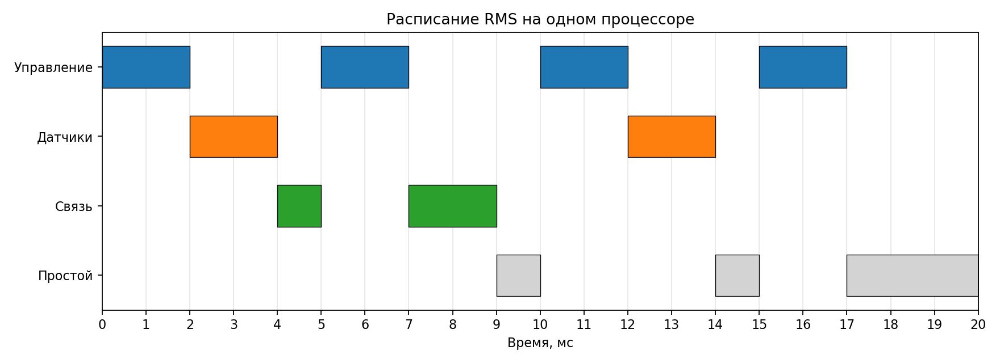

# RMS & EDF Scheduler

> Анализ планируемости периодических задач бортовой системы

---

## Описание ✍️😴

**RMS & EDF Scheduler** - консольное приложение на Python для анализа планируемости периодических задач в системах реального времени.

Программа проверяет, смогут ли задачи выполняться до установленных дедлайнов при использовании алгоритмов **Rate Monotonic Scheduling (RMS)** и **Earliest Deadline First (EDF)**.

В рамках практической работы рассматривается **бортовая система**, состоящая из трёх задач:

- Управление - вычисление управляющих команд
- Датчики - обработка показаний датчиков
- Связь - обмен данными с другими устройствами

Для каждой задачи задаются время выполнения `C`, период `T` и дедлайн `D`.

---

## Основные возможности 🧠

- Расчёт коэффициента загрузки процессора
- Автоматическое назначение приоритетов по алгоритму RMS
- Расчёт границы Liu & Layland
- Проверка достаточного условия планируемости RMS
- Проверка планируемости по EDF для задач с `D = T`
- Расчёт времени отклика задач методом RTA
- Учёт вытеснения менее приоритетных задач
- Проверка соблюдения дедлайнов
- Расчёт гиперпериода
- Моделирование расписания RMS
- Построение диаграммы Ганта
- Сохранение диаграммы в PNG
- Чтение параметров из JSON
- Проверка корректности входных данных
- Вывод результатов в консоль

---

## Технологии 🏎️

| Технология | Назначение |
|---|---|
| **Python 3.12.3** | Основной язык программирования |
| **dataclasses** | Описание модели периодической задачи |
| **JSON** | Хранение параметров задач |
| **Matplotlib** | Построение диаграммы Ганта |
| **pytest** | Автоматическое тестирование |
| **Git** | Контроль версий |
| **GitHub** | Хранение репозитория и истории разработки |
| **VS Code** | Среда разработки |

---

## Входные данные 📄

### `data/tasks.json`

Для анализа используется набор из трёх периодических задач бортовой системы.

| Задача | C, мс | T, мс | D, мс |
|---|---:|---:|---:|
| Управление | 2 | 5 | 5 |
| Датчики | 2 | 10 | 10 |
| Связь | 3 | 20 | 20 |

где:

- `C` - наихудшее время выполнения задачи (WCET)
- `T` - период запуска задачи
- `D` - относительный дедлайн задачи

В данном наборе для всех задач выполняется условие `D = T`.

Приоритеты RMS определяются автоматически: чем меньше период задачи, тем выше её приоритет.

Таким образом, задача управления имеет наивысший приоритет, а задача связи - наименьший.

---

## Расчёты 📐

### Коэффициент загрузки процессора

Загрузка определяется суммой отношений времени выполнения к периоду каждой задачи:

$$
U = \sum_{i=1}^{n}\frac{C_i}{T_i}
$$

Для выбранного набора:

$$
U = \frac{2}{5}+\frac{2}{10}+\frac{3}{20}=0.75
$$

Итоговая загрузка процессора составляет **75%**.

### Планирование RMS

В алгоритме RMS приоритеты задач фиксированы и назначаются по периодам.

Для проверки используется достаточная граница Liu & Layland:

$$
U_{LL}=n(2^{1/n}-1)
$$

Для трёх задач:

$$
U_{LL}=3(2^{1/3}-1)\approx0.77976
$$

Поскольку:

$$
0.75\le0.77976
$$

набор проходит достаточный тест планируемости RMS.

Если загрузка превышает границу Liu & Layland, это само по себе ещё не означает нарушение дедлайнов. В таком случае требуется дополнительный анализ.

### Планирование EDF

В алгоритме EDF наивысший приоритет получает задача с ближайшим абсолютным дедлайном.

Для рассматриваемой модели с неявными дедлайнами `D = T` используется условие:

$$
U\le1
$$

Для нашего набора:

$$
0.75\le1
$$

Следовательно, набор задач планируем по EDF в рамках принятой модели.

### Анализ времени отклика RTA

Для расчёта максимального времени отклика используется рекуррентная формула:

$$
R_i^{(k+1)}=C_i+\sum_{j\in hp(i)}
\left\lceil\frac{R_i^{(k)}}{T_j}\right\rceil C_j
$$

где:

- $R_i$ - время отклика рассматриваемой задачи
- $C_i$ - её собственное время выполнения
- $hp(i)$ - задачи с более высоким приоритетом
- $T_j$ - период более приоритетной задачи
- $C_j$ - время её выполнения

Расчёт повторяется до стабилизации значения либо до обнаружения превышения дедлайна.

Для выбранного набора получены результаты:

| Задача | C, мс | D, мс | R, мс | Дедлайн |
|---|---:|---:|---:|---|
| Управление | 2 | 5 | 2 | Соблюдается |
| Датчики | 2 | 10 | 4 | Соблюдается |
| Связь | 3 | 20 | 9 | Соблюдается |

Все задачи укладываются в свои дедлайны.

### Гиперпериод

Гиперпериод определяется как наименьшее общее кратное периодов задач:

**H = НОК(T₁, T₂, ..., Tₙ)**

Для периодов 5, 10 и 20 мс:

**H = НОК(5, 10, 20) = 20 мс**

На интервале от 0 до 20 мс строится диаграмма выполнения задач по RMS.

---

## Архитектура программы ❤️‍🩹

Основные файлы проекта:

- `main.py` - консольный запуск, загрузка задач и вывод результатов
- `src/scheduler.py` - модель задач, расчёты RMS, EDF, RTA и моделирование расписания
- `src/plotting.py` - построение диаграммы Ганта
- `data/tasks.json` - исходные данные бортовой системы
- `tests/` - автоматические тесты программы
- `docs/rms_gantt.png` - диаграмма выполнения задач
- `requirements.txt` - зависимости проекта

Обязательные расчётные функции:

- `utilization(tasks)`
- `liu_layland_bound(n)`
- `rms_schedulable(tasks)`
- `edf_schedulable(tasks)`
- `response_time(task, higher)`
- `gantt(tasks, interval)`

---

## Диаграмма Ганта 📊

Программа моделирует выполнение задач на одном процессоре с использованием вытесняющего планирования RMS.

При появлении более приоритетной задачи текущая задача может быть прервана. После завершения более приоритетной задачи прерванная продолжает выполнение.

На диаграмме отображаются:

- интервалы выполнения каждой задачи
- вытеснение задач
- продолжение прерванного выполнения
- периоды простоя процессора

Результат сохраняется в файле:

`docs/rms_gantt.png`



---

## Как запустить 🚀

### Требования

- Python 3.10+
- Git

### Клонирование репозитория

```bash
git clone https://github.com/jota2069/rms-edf-lab3.git
cd rms-edf-lab3
```

### Создание виртуального окружения

```bash
python3 -m venv .venv
source .venv/bin/activate
```

### Установка зависимостей

```bash
pip install -r requirements.txt
```

### Запуск программы

```bash
python3 main.py
```

Программа загружает исходные данные, рассчитывает временные характеристики задач, выводит результаты проверок RMS, EDF и RTA, а также сохраняет диаграмму Ганта.

### Запуск тестов

```bash
python3 -m pytest
```

---

## Результат 📊

Для выбранного набора задач программа определяет:

- Коэффициент загрузки - **0.75 (75%)**
- Граница Liu & Layland - **0.77976**
- Тест RMS - **пройден**
- Проверка EDF - **набор планируем**
- Время отклика управления - **2 мс**
- Время отклика датчиков - **4 мс**
- Время отклика связи - **9 мс**
- Гиперпериод - **20 мс**
- Количество задач - **3**
- Соблюдение дедлайнов - **все задачи успевают**

Таким образом, выбранный набор периодических задач удовлетворяет временным ограничениям при рассматриваемых алгоритмах планирования.

---

## Тестирование 🧪

Для проверки программы используется `pytest`.

Реализованы тесты:

- расчёта загрузки процессора
- границы Liu & Layland
- проверки RMS
- проверки EDF
- анализа времени отклика RTA
- выполнения и нарушения дедлайнов
- назначения приоритетов
- расчёта гиперпериода
- вытесняющего планирования
- продолжения прерванных задач
- простоя процессора
- загрузки JSON
- обработки некорректных входных данных
- формирования расписания и диаграммы

Текущий результат:

```text
25 passed
```

---

## Git 🗿

Разработка проекта организована с использованием веток `main` и `develop`.

Основные изменения выполнялись в отдельных feature-ветках:

- `feature/data-model`
- `feature/rms-edf`
- `feature/rta`
- `feature/gantt`
- `feature/tests`

После завершения каждого этапа изменения объединялись с `develop`. Проверенная версия затем была объединена с `main`.

В истории проекта сохранены:

- **10 содержательных коммитов** в feature-ветках
- **6 merge-коммитов**
- **7 веток**

Все feature-ветки сохранены в репозитории.

---

## Автор 💝🏆🧊🆒

Ногеров А.И. - [@jota2069](https://github.com/jota2069)